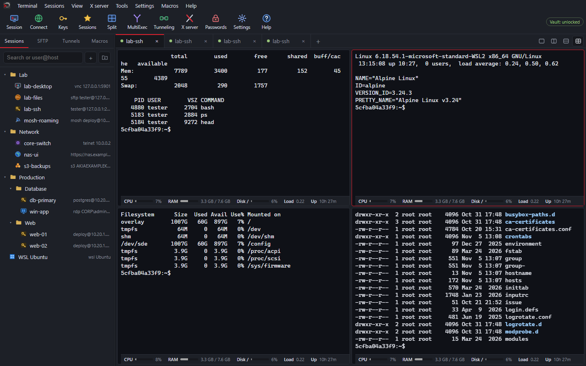
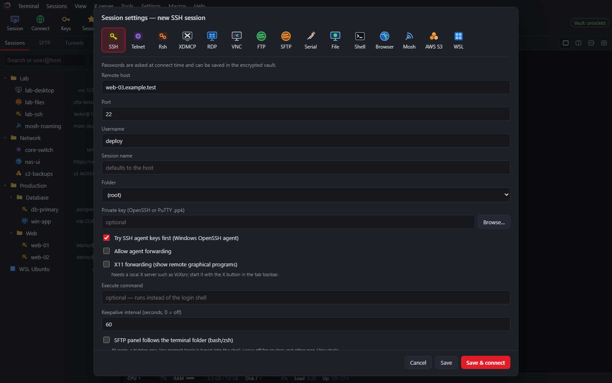
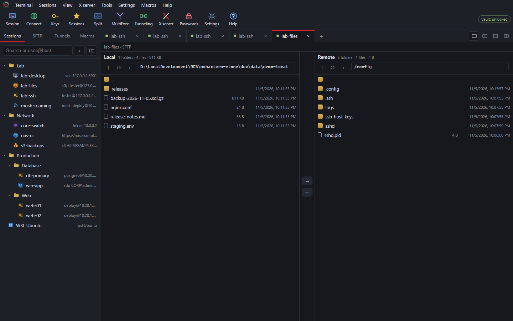
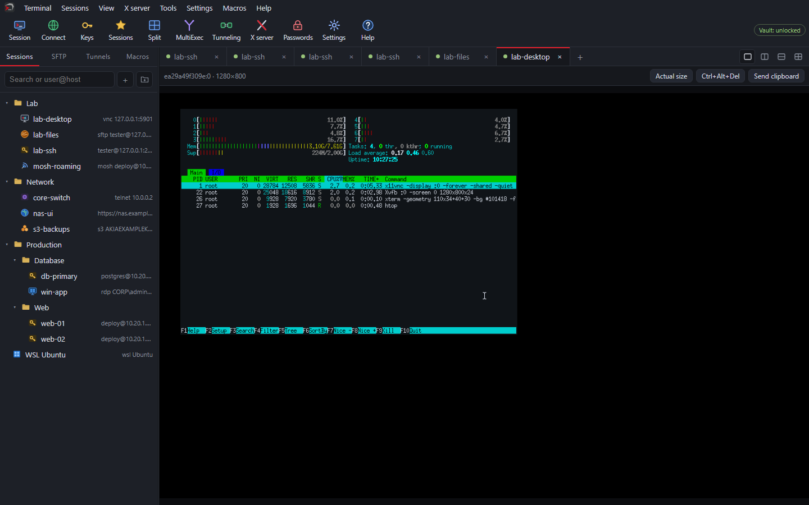
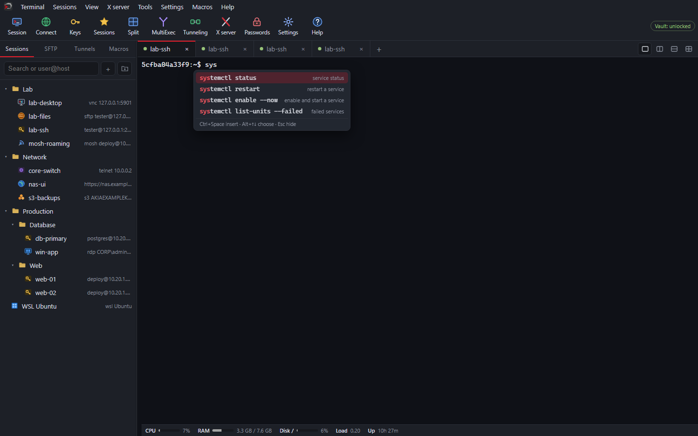

<p align="center">
  
</p>

<p align="center">
  <a href="https://github.com/sergiojosevalente/moxtel/releases/latest"></a>
  
  
  
</p>

<h3 align="center">One window for every server you manage.</h3>

<p align="center">
  SSH, Telnet, RDP, VNC, SFTP/FTP/S3, Serial, Mosh, WSL and more — with encrypted saved sessions,
  automatic file transfers and network tools. Free for Windows 10 and 11.
</p>

<p align="center">
  <a href="https://github.com/sergiojosevalente/moxtel/releases/latest"><b>⬇ Download the latest version</b></a>
  ·
  <a href="#bahasa-indonesia">Bahasa Indonesia</a>
</p>

---

<p align="center"></p>

<table>
  <tr>
    <td width="50%"></td>
    <td width="50%"></td>
  </tr>
  <tr>
    <td align="center"><b>15 session types</b></td>
    <td align="center"><b>SFTP / FTP / FTPS / S3, two panes</b></td>
  </tr>
  <tr>
    <td width="50%"></td>
    <td width="50%"></td>
  </tr>
  <tr>
    <td align="center"><b>Built-in VNC and RDP</b></td>
    <td align="center"><b>Command suggestions</b></td>
  </tr>
</table>

## Features

- **Tabbed terminals** — PowerShell, CMD, WSL, Git Bash; split into 2 or 4 panes; MultiExec; macros; zoom per tab; easy-on-the-eyes Charcoal theme and 9 more; tab colors; detach a tab into a floating window or move it to its own window; command palette (Ctrl+Shift+P) and 400+ command suggestions.
- **SSH** — keys (OpenSSH and PuTTY `.ppk`), OpenSSH certificates, Windows OpenSSH agent or PuTTY Pageant, chained jump hosts, SOCKS5/HTTP proxy, tunnels (`-L`, `-R`, SOCKS), X11 forwarding, colour-coded server monitoring under the terminal (CPU, RAM, swap, disks, network, load).
- **15 session types** — SSH, Telnet, Rsh, XDMCP, RDP (embedded in a tab, full screen and zoom), VNC (built-in viewer), FTP, SFTP, Serial, File, Shell, Browser, Mosh, AWS S3, WSL.
- **Files** — two-pane SFTP/FTP/FTPS/S3 browser, transfer queue, edit remote files with automatic upload.
- **Auto Transfer** — upload, download, mirror or two-way sync between a local folder and any saved server (or server to server); filters, conflict rules, preview; up to 32 files at once with a live transfer queue (progress per file, reorder, remove); schedules, folder watch, retries; runs from the tray, the command line (`moxtel -run-transfer "name"`) or Windows Task Scheduler; history, Windows notifications and e-mail reports.
- **Network tools** — ping, traceroute, TCP ping, port scanner, SSL/TLS certificate checker.
- **Recordings** — record a terminal session (asciinema `.cast`) and replay it.
- **Import** — sessions from MobaXterm, PuTTY/KiTTY, WinSCP, mRemoteNG, SuperPuTTY and OpenSSH config (passwords are never imported).

## Privacy and security

- No account, no cloud, no telemetry. Moxtel connects only to the servers you open — and to github.com when you check for updates.
- Saved sessions are encrypted for your Windows account (DPAPI); passwords are kept in a vault protected by your master password (Argon2id + AES-256-GCM).
- Updates are installed only when their signature (Ed25519) and checksum (SHA-256) match.
- Imported backups never start anything by themselves: Auto Transfer profiles arrive switched off and tunnels do not auto-start. Files opened from a server for editing are never run.

Details: [SECURITY.md](SECURITY.md).

## Install

1. Download **`moxtel-setup-<version>.exe`** from the [latest release](https://github.com/sergiojosevalente/moxtel/releases/latest).
2. Run it. It installs for your Windows user only — no administrator rights — and adds Moxtel to the Start menu.
3. Uninstall any time from **Settings → Apps → Installed apps**.

A portable **`moxtel.exe`** is also attached to each release: it runs from any folder, without installing (it cannot update itself).

> **"Windows protected your PC"?** The installer is not code-signed yet, so Windows SmartScreen may warn the
> first time. Click **More info → Run anyway**. You can check the download against `SHA256SUMS` in the release:
>
> ```powershell
> Get-FileHash .\moxtel-setup-<version>.exe -Algorithm SHA256
> ```

Requirements: Windows 10 or 11 (64-bit) with the Microsoft Edge WebView2 Runtime (included in Windows 11).

## Updates

**Help → Check for updates** shows what is new and updates Moxtel in place; your sessions and settings are kept.
You can also turn on a check at startup in **Settings → Configuration → General**.

## Command line

```powershell
moxtel.exe -ssh root@10.0.0.5:22          # quick connect
moxtel.exe -session "web-01"              # open a saved session
moxtel.exe -newtab wsl                    # local terminal (pwsh, powershell, cmd, wsl, gitbash)
moxtel.exe -run-transfer "Backup Portal"  # run an Auto Transfer profile without a window
moxtel.exe -tray                          # start in the notification area
moxtel.exe -data D:\portable\moxtel       # use another data folder
```

## Feedback

Found a bug or have an idea? [Open an issue](https://github.com/sergiojosevalente/moxtel/issues).
Please do not post passwords, host names or other private details. Security problems: see [SECURITY.md](SECURITY.md).

## License

Moxtel is **freeware**: free for personal and commercial use, closed source. See [LICENSE.txt](LICENSE.txt).
It is built with open-source components, listed with their licenses in [THIRD_PARTY_NOTICES.txt](THIRD_PARTY_NOTICES.txt).

Moxtel is an independent project by [Sergio Valente](https://sergiojosevalente.github.io/) and is not affiliated with
Mobatek (MobaXterm) or any other vendor.

---

## Bahasa Indonesia

**Moxtel** adalah aplikasi terminal all-in-one untuk Windows: SSH, Telnet, RDP, VNC, SFTP/FTP/S3, Serial, Mosh, WSL
dan lainnya dalam satu jendela. **Gratis** (freeware), tanpa akun, tanpa cloud, dan data tersimpan terenkripsi hanya di komputermu.

**Cara install:** unduh `moxtel-setup-<versi>.exe` dari [rilis terbaru](https://github.com/sergiojosevalente/moxtel/releases/latest),
lalu jalankan. Tidak perlu hak administrator. Jika muncul peringatan *Windows protected your PC*, klik
**More info → Run anyway** (installer belum ditandatangani dengan sertifikat code signing).

**Update:** menu **Help → Check for updates**. Sesi dan pengaturanmu tetap aman.

**Laporan bug / ide:** buka [issue](https://github.com/sergiojosevalente/moxtel/issues) — jangan sertakan password atau data server.
